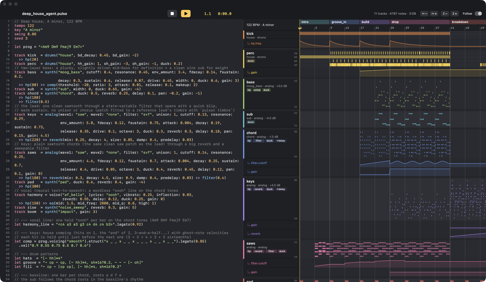
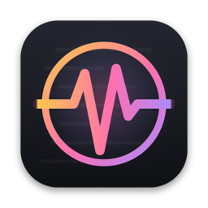

<p align="center">
  
</p>

<p align="center"></p>
<h1 align="center">Pulsar</h1>
<p align="center"><b>Electronic music as code, built for AI.</b><br>
A small, readable music language · a studio-grade synthesis engine · a mix report that replaces ears.</p>

<p align="center">
  <a href="https://ronreiter.github.io/pulsar/">Website</a> ·
  <a href="https://ronreiter.github.io/pulsar/#listen">Listen</a> ·
  <a href="pulsar/LANGUAGE.md">Language reference</a> ·
  <a href="#pulsar-studio-macos">Pulsar Studio</a>
</p>

---

An AI model writes a song in Pulsar, renders it, reads the mix report (loudness, tonal
balance, energy per section, masking between tracks) and revises it — no ears required.
[`examples/deep_house_agent.pulse`](examples/deep_house_agent.pulse) was written by a fresh
agent that was given nothing but `pulsar docs` and the CLI.
**[Hear it on the website →](https://ronreiter.github.io/pulsar/#listen)**
[`examples/night_bus.pulse`](examples/night_bus.pulse) is a second deep house track built around
a clean sawtooth lead whose patch was fitted to a reference recording with `pulsar timbre`, and
[`examples/skyline.pulse`](examples/skyline.pulse) is an epic progressive-house track with layered
chords and the same lead bathed in reverb.

```
tempo 122
key "A minor"

track kick = drums("house")
track bass = synth("moog_bass", duck: 0.6) >> comp(ratio: 3)
track pad  = synth("pad", reverb: 0.4, duck: 0.6)

let prog = "<Am9 Dm9 Fmaj9 Em7>"

section intro 8 {
  play kick "bd*4, [~ hh]*4"
  play pad  prog.voicing("smooth")
  automate pad.cutoff 0.25 -> 0.5
}
section drop 16 extends intro {
  play kick "bd*4, ~ cp ~ cp, [~ hh]*4"
  play bass "<a1 d2 f1 e1>".struct("x ~ ~ x ~ ~ x ~")
}
arrange intro, drop, drop
```

```
$ pulsar render song.pulse -o song.mp3
loudness -10.0 LUFS   true peak -1.0 dBTP   crest 10.2 dB
spectrum (dB vs loudest band): sub +0  bass -1  low_mid -3  mid -11  presence -17 ...
energy arc:
  intro        bar    0   -12.1 LUFS  ###########
  drop         bar   24    -8.8 LUFS  ##############
- chord and keys both peak in the low_mid band and may mask each other; ...
```

## Why it's built this way

**A language models already almost know.** Rhythm uses TidalCycles-style mini-notation
(`"bd*4, ~ cp ~ cp"`, `"<Am F C G>"`, `"bd(3,8)"`), wrapped in a tiny conventional syntax:
tracks, sections that extend each other, `play`, `automate`, `arrange`, plus `let`,
functions, lambdas, loops and conditionals. Steps can be note names, scale degrees, chord
symbols or roman numerals in the song's key; `.voicing("smooth")` voice-leads progressions.
Errors carry line, column and "did you mean".

**Sound quality first.** Faust DSP compiled to native code through DawDreamer, rendered note
by note at 96 kHz and placed sample-exactly:
- band-limited oscillators with unison and analog drift; Moog ladder, TB-303 diode,
  Korg MS-20 and Oberheim SEM filter models; FM and Karplus-Strong engines;
- 14 synthesized drum voices in 5 kits, a sampler (pitch / slice / gate / fit);
- neural singing and speaking voices (Kokoro-82M, 54 voices, local): lyrics sung one word
  per note, re-pitched with the WORLD vocoder so formants stay natural, optionally doubled;
- Zita reverb, ping-pong delay, chorus, saturation, EQ, compression, sidechain ducking;
- glue compression, a 4× oversampled soft clipper and a true-peak limiter to a LUFS target.

**Defaults are mixed.** 34 presets are loudness-calibrated with balanced faders, so a song
that only picks presets already sits right; `gain:` is relative to that.

**Feedback replaces listening.** Every render reports loudness, true peak, spectral balance,
stereo image, the energy arc per section, per-track levels, masking — and concrete fixes.
Match a reference you own with `pulsar compare` / `pulsar match`, or fit a synth patch to a
recording's timbre with `pulsar timbre`.

## Install

Python 3.10+ (macOS or Linux), ffmpeg for MP3 export.

```sh
git clone https://github.com/ronreiter/pulsar && cd pulsar
uv venv --python 3.12 .venv && uv pip install --python .venv/bin/python -e ".[mcp,voice,dev]"
```

The `voice` extra adds the text-to-speech singer; its model (~350 MB) downloads on first use.

## Use

```sh
pulsar docs                                     # the language reference — give this to the model
pulsar check song.pulse                         # compile; prints sections, tracks, note ranges
pulsar render song.pulse --play                 # mastered 48 kHz WAV + mix report
pulsar render song.pulse -o song.mp3            # 320 kbps MP3 (--mp3 writes both)
pulsar render song.pulse --only drop            # one section, for fast iteration
pulsar render song.pulse --stems stems/         # per-track stems
pulsar presets / pulsar params                  # sounds and every parameter
pulsar voices                                   # the singing / speaking voices
pulsar compare mine.wav reference.wav           # sonic profile side by side
pulsar match song.pulse reference.wav           # tune a master EQ toward a reference
pulsar timbre recording.wav --register c3-c5    # fit a synth patch to a recording's timbre
```

(`pulsar` is `.venv/bin/pulsar` if the venv isn't activated.)

### Pulsar Studio (macOS)

A native editor with an Ableton-style arrangement beside it: piano rolls for melodic tracks,
one row per voice for drums, automation curves under their tracks, sections on the ruler,
and a playhead that lights up notes as they sound. The song recompiles as you type.

```sh
app/build_app.sh && open "app/build/Pulsar Studio.app"    # needs only the Xcode command line tools
```

⌘R play / pause · ⌘. stop · ⌘⇧R re-render · ⌘= / ⌘- zoom time (pinch, ⌘-scroll) ·
⌥⌘= / ⌥⌘- stretch lanes (⌥-pinch, ⌥-scroll) · ⌘0 reset zoom · click the ruler to seek ·
click a track header to jump to its line.

### MCP

`pulsar mcp` serves `reference`, `check`, `render` (WAV or MP3), `analyze_file` and `play`
over stdio, so an agent can compose, render, read the report and revise.

```sh
claude mcp add pulsar -- /path/to/pulsar/.venv/bin/pulsar mcp
```

## Layout

| path | what |
|---|---|
| `pulsar/grammar.lark`, `parser.py`, `interp.py` | grammar, parser and evaluator |
| `pulsar/pattern.py`, `theory.py` | pattern engine, mini-notation, notes/scales/chords |
| `pulsar/song.py` | song model and compilation to timed notes |
| `pulsar/presets.py` | the instrument library |
| `pulsar/dsp/` | Faust voices and effects, engine wrapper, mastering |
| `pulsar/render.py` | per-note rendering, mixing, parallel workers |
| `pulsar/analyze.py`, `match.py`, `timbre.py` | mix report, reference matching, timbre fitting |
| `pulsar/LANGUAGE.md`, `docs.py` | the reference (preset tables generated from code) |
| `app/` | Pulsar Studio (SwiftUI) |
| `docs/` | the website |
| `tools/make_vox.py` | synthesizes sung-vowel samples for trying the sampler |

## Contributing

Issues and pull requests are welcome — new presets, effects, pattern methods, and songs
written by models especially. Run `pytest -q` before sending a change.

## License

GPL-3.0 (Pulsar builds on [DawDreamer](https://github.com/DBraun/DawDreamer), which is GPL-3.0,
and the [Faust](https://faust.grame.fr) libraries).
